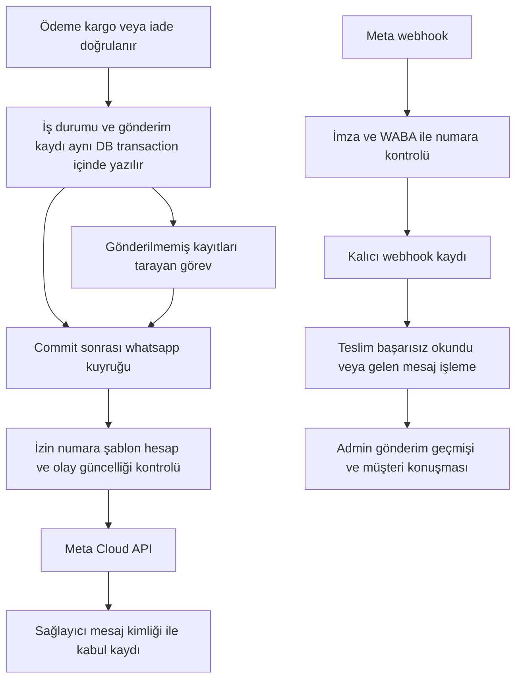

# Sportoonline WhatsApp Business entegrasyon araştırması ve uygulama checklisti

Tarih: 8 Kasım 2026. Durum: uygulama ve canlı yazılım yayını tamamlandı; gerçek yönetici panel kabulü geçti. Yeni numara/Meta hesap kurulumu ve gerçek teslim kabulü bekliyor. Güncel kanıtlar: [yayın kaydı](WHATSAPP-UYGULAMA-VE-YAYIN.md).

Sportoonline müşterilerine ayrı bir WhatsApp numarasından sipariş, ödeme, kargo ve iade bildirimleri gönderecek. OSGB projesindeki Meta Cloud API mimarisi Laravel 12 ve mevcut Next.js panellerine uyarlanacak. İlk teslimat, izinli bir pilot alıcıya ödeme bildiriminin gönderilmesi ve teslim sonucunun webhook ile kanıtlanmasıdır. Sonraki adımlarda kargo, iade ve gelen mesaj yönetimi tamamlanır.

`[X]` kanıtıyla tamamlanan araştırmayı, `[ ]` yapılacak işi belirtir. Kodun tamamlanması, dağıtılması ve gerçek mesajın teslim edilmesi ayrı kabul adımlarıdır. Bu doküman canlı migration, Meta aboneliği, şablon başvurusu veya müşteri mesajı oluşturmaz.

## 1 Kararlar ve kapsam

| Konu | Karar veya tamamlanacak bilgi |
| --- | --- |
| Gönderici numarası | Kullanıcı kararı: OSGB numarasından ayrı olacak. |
| Uygulama | Mevcut Laravel backend içinde Meta Cloud API HTTP istemcisi; ayrıca Node servisi gerekmiyor. |
| Hesap bağlama | OSGB gibi yönetici panelinden WABA ID, Phone Number ID, token ve App Secret girme. Embedded Signup ilk sürümün gereği değil. |
| Numara geçmişi | Yeni numara mı, WhatsApp Business uygulamasında/BSP üzerinde mi kayıtlı: Meta kurulumunda doğrulanacak. Ayrı numara, kullanılmamış numara demek değildir. |
| Meta kaynakları | WABA, App ve sistem kullanıcısı kimlikleri henüz belirlenmedi. Tercih edilen kurulum Sportoonline'a ait WABA + ayrı App + kapsamı bu işe ait token; aynı Business Portfolio altında yönetilebilirliği hesapta doğrulanacak. Ortak WABA seçilirse abonelik ve olay yönlendirme izolasyonu ayrıca kanıtlanmalı. |
| Gönderici kapsamı | Platform adına tek numara; her satıcının hesabını bağlama ilk sürümde yok. |
| İlk bildirim | Doğrulanmış ödeme sonrası tek müşteri bildirimi. Kapıda ödeme için ayrı sipariş kabul mesajı. |
| Diğer kanallar | Mevcut e-posta ve uygulama bildirimleri devam eder. WhatsApp başarısızlığı ayrıca ikinci e-posta üretmez. |
| İlk canlı kullanım | Sınırlı pilot alıcı listesi, ardından açıkça etkinleştirilen otomasyon. Eski siparişler otomatik gönderime alınmaz. |
| Sonraki kapsam | Kargo, teslimat, iptal/iade; ardından OSGB benzeri konuşma ekranı ve dosya iletimi. |
| Ayrı sonraki çalışma | Kampanya, terk edilmiş sepet, fiyat alarmı, toplu gönderim, WhatsApp OTP ve yapay zekâ yanıtları. |

## 2 Araştırma başlangıcında doğrulanan durum

### QuickEcommerce

- [X] `backend-laravel/app`, `routes`, `config`, `database/migrations`, admin ve müşteri web kaynakları tarandı. Uygulamaya ait WhatsApp gönderim servisi, webhook ve hesap bağlama ekranı bulunmadı. Vendor SDK içindeki WhatsApp sınıfları entegrasyon sayılmadı.
- [X] Canlı sunucuda yalnız okuma yapıldı: `queue.default=database`, etkin driver `database`, `after_commit=false`, `retry_after=90` saniye; `services.whatsapp` yok, `whatsapp%` adlı tablo yok. Başka isimli tablolar veya Meta paneli bu kontrolle doğrulanmış sayılmaz.
- [X] `OrderService::createOrder()` içindeki `new-order` bildirimi `DB::commit()` öncesinde çağrılıyor. Ödeme başarısını ifade etmiyor.
- [X] `OrderManageNotificationService` alt siparişler üzerinde döngüyle panel bildirimi, Firebase ve e-posta üretiyor. Ödeme mesajını bu döngüye eklemek çok mağazalı siparişte tekrar üretir.
- [X] `IyzicoPaymentController::callback()` ödeme doğrulandıktan sonra ana ve alt siparişleri `paid` yapıyor. İncelenen başarı kolunda tekrar çağrıya karşı WhatsApp için kullanılabilecek kalıcı olay anahtarı bulunmuyor.
- [X] `PlaceOrderController` cüzdan ödemesini ayrıca güncelliyor. PayTR, Stripe, admin onayı ve kapıda ödeme yolları da var; aktif olanlar üretim öncesi envanterlenecek.
- [X] `GdeliverWebhookController` bazı durumları `withoutEvents()` ile yazıyor. `IyzicoRefundService` toplu SQL güncellemesi yapıyor. Yalnız Eloquent observer eklemek bütün olayları yakalamaz.
- [X] Müşteride `marketing_email`, `marketing_sms`, `phone`; sipariş adresinde `contact_number` var. WhatsApp izin kaydı ve numaraya bağlı izin geçmişi yok.
- [X] Gerçek müşteri checkout yolu `src/app/[locale]/odeme/checkout-client.tsx`; hesap yolu `src/app/[locale]/hesabim/account-client.tsx`. Eski görev metnindeki `/checkout` yolu temel alınmayacak.
- [X] Gerçek admin API öneki `/api/v1/admin`; `bootstrap/app.php` ve `routes/admin-api.php` ile doğrulandı. Yeni endpointler `/admin-api/v1` varsayımıyla yazılmayacak.
- [X] Etkin `permission` middleware alias'ı Spatie sınıfına gidiyor. İsmi benzer yerel `CheckPermission` sınıfı izin kontrolü örneği olarak kullanılmayacak.

Araştırmanın yerel QuickEcommerce HEAD'i `20a51f80`, getirilen `origin/main` tabanı `ce31b675`. Sipariş, ödeme, kargo ve iade kaynaklarının bir kısmı `main` ile farklı; `UnpaidOrderReleaseService` incelenen yerelde var, bu `main` tabanında yok. Uygulama dalı açılmadan kaynak sürümleri eşleştirilecek. Dokümantasyon PR'ı yalnız bu planı ve görev listesi girişini içerir.

### OSGB kaynak mimarisi

Kaynak kökü: `/home/orhan/Documents/Projeler/osgb-yazilim`. Aşağıdaki tespitler mevcut yerel koddan gelir; OSGB hesabının bugünkü Meta gönderim sağlığı bu incelemede sorgulanmadı.

| Kaynak | Mevcut davranış | Laravel uyarlaması |
| --- | --- | --- |
| `backend/src/modules/whatsapp/credentialStore.ts` | AES ile şifreli, 0600 izinli dosya ve atomik yenileme | Laravel şifreleme altyapısı; sunucuda şifreli credential alanları ve API yanıtlarından çıkarma |
| `service.ts`, `setup.ts` | WABA içindeki numara aidiyeti, bağlantı, token, Meta HTTP çağrıları | `WhatsappConnectionService` ve `WhatsappCloudClient`; bağlantı doğrulama ve webhook aboneliğini ayrı işlemler olarak sunma |
| `accountHealth.ts` | Bağlantı ile gönderim engelini ayırır | `configured`, `connected`, `messaging_status`, `checked_at`, hata nedeni ayrı alanlar |
| `webhook.ts` | GET challenge, ham gövdede HMAC, gelen mesaj, teslim durumu | `WhatsappWebhookController`, imza middleware'i ve kalıcı webhook gelen kutusu |
| `followupTemplate.ts`, `financeTemplate.ts` | Meta şablon durumu, dil ve içerik kontrolü | Sportoonline olaylarına özel şablon eşlemesi ve sürümlü parametre sözleşmesi |
| `followupClaim.ts` | Aynı isteğe tek gönderim; belirsiz sonuçta tekrar engeli | İş olayı başına benzersiz gönderim ve ayrı deneme kayıtları |
| `teslimDurum.ts`, `inbound.ts` | Erken/sırasız webhook, mesaj kimliği, teslim ve okundu ayrımı | Meta kabulü ile teslimi ayıran durumlar; callback olaylarını saklayıp yeniden işleme |
| `identity.ts`, `identityRepository.ts` | Telefon ve telefon dışı WhatsApp kimliklerini ayırır | E.164 numara + nullable sağlayıcı kimliği; bilinmeyen kimlikleri telefona dönüştürmeme |
| `konusmaYetki.ts`, `controller.ts` | Konuşma ve gönderim yetkileri | Mevcut Sanctum, müşteri guard'ı ve Spatie izinleriyle uyarlama |
| `media.ts`, `readReceipt.ts`, `outOfHoursReply.ts` | Dosya iletimi, okundu bilgisi, mesai dışı yanıt | İlk bildirim pilotundan sonra ayrı paket |
| `admin_panel/.../iletisim-crm/whatsapp-account-dialog.tsx` | Hesap bağlama formu ve bağlantı durumu | QuickEcommerce admin bileşen ve API modül düzenine yeniden yazma |

Doğrudan taşınmayacak değerler: `osgb.tech` callback adresi, `aktif360_*` şablon adları, `firma_id` ilişkileri, OSGB rol kodları, credential dosyası ve şifreleme anahtarı. OSGB kurulumunda Graph `v23.0` sabit; Sportoonline sürümü yapılandırılacak ve uygulama tarihinde desteklendiği doğrulanacak.

İncelenen OSGB webhook'u beklenen WABA ve `metadata.phone_number_id` ile filtrelemiyor; gövdedeki mesajları işliyor. Ayrı numara aynı WABA'da kullanılacaksa aboneliğin hangi numaraların olaylarını mevcut OSGB uygulamasına ileteceği doğrulanmalı. OSGB'ye Sportoonline olaylarının da ulaşması mümkün olan bir hesap düzeni, yalnız Sportoonline tarafına filtre eklemekle izole edilmiş sayılmaz. Ortak WABA gerekecekse OSGB tarafındaki yönlendirme için ayrı ve dar kapsamlı iş paketi gerekir.

## 3 Resmî kaynak araştırması

8 Kasım 2026 tarihinde erişilen kaynaklar:

| Kaynak | Planı etkileyen sonuç |
| --- | --- |
| [WhatsApp Business Messaging Policy](https://business.whatsapp.com/policy) | Alıcının iletişim izni ve vazgeçme talepleri dikkate alınmalı. İşletmenin başlattığı mesajlarda onaylı şablon, 24 saat dışındaki yanıtlarda da şablon gerekiyor. |
| [WhatsApp Business Platform Pricing](https://business.whatsapp.com/products/platform-pricing) | Ücretlendirme teslim edilen mesaj, alıcı pazarı ve kategoriye bağlı. Sipariş/teslimat gibi işlem mesajları utility; terk edilmiş sepet ve promosyonlar marketing kapsamında anlatılıyor. |
| [Laravel 12 kuyruk ve transaction davranışı](https://laravel.com/docs/12.x/queues#jobs-and-database-transactions) | `afterCommit()` bir işi açık transaction tamamlandıktan sonra kuyruğa alabilir. Kalıcı gönderim kaydı ayrıca commit ile kuyruklama arasındaki kesintiyi telafi edecek. |

Meta geliştirici sayfaları bu araştırmada 429/erişim hatası verdi. Dolayısıyla aşağıdakiler mevcut OSGB uygulamasına dayanan uyarlama adaylarıdır; hesap kurulumu öncesi güncel sözleşmeyle doğrulanacak:

- Graph sürümü, gerekli izinler ve yeni numaranın kayıt/geçiş yöntemi.
- `subscribed_apps`, callback override kapsamı ve aynı WABA'da birden çok uygulamanın olay dağılımı.
- Mesaj göndermenin alanları, webhook `phone_number_id`, sağlayıcı kimliği ve callback korelasyon alanları.
- Şablon durum/kalite değişikliği olayları, hata kodları ve bu hesaba uygulanan gönderim limitleri.

Referans başlangıçları: [Cloud API](https://developers.facebook.com/docs/whatsapp/cloud-api/), [mesaj gönderimi](https://developers.facebook.com/documentation/business-messaging/whatsapp/messages/send-messages), [webhook](https://developers.facebook.com/docs/whatsapp/cloud-api/webhooks). Bu bağlantılar doğrulanmış hesap durumu veya şablon onayı yerine geçmez. Sabit Türkiye fiyatı ve gönderim limiti bu plana yazılmadı; canlı Meta hesabındaki değerlerle maliyet tablosu doldurulacak.

## 4 Hedef mimari

Gönderim kaydı, yapılacak bildirimi veritabanında tutar; bu tasarım genellikle outbox olarak adlandırılır. Kuyruk yalnız bu kaydın kimliğini taşır. Meta çağrısı ödeme callback'inin, checkout yanıtının veya açık veritabanı transaction'ının içinde çalışmaz. Ağ kesintisi alışveriş yanıtını bekletmez.

Gönderim garantisi: benzersiz iş kaydı ile tekrarlar engellenir; dış servise tam bir kez teslim garantisi varsayılmaz. Meta isteği kabul edip yanıt kaybolursa kayıt `unknown` olur. Kör yeniden deneme yapılmaz; webhook veya izinli inceleme ile sonuç çözülür.

### Olaylar ve tekilleştirme

| Olay | Tetikleme ve veri kaynağı | Benzersiz anahtar kapsamı | Müşteri mesajı |
| --- | --- | --- | --- |
| `payment_confirmed` | Aktif ödeme sağlayıcısının doğrulanmış başarı sonucu; `OrderMaster` | `payment_confirmed:master_id:payment_reference` | Ödemeniz alındı |
| `cod_order_accepted` | Kapıda ödeme uygunluğu ve siparişin kaydı kesinleşince | `cod_order_accepted:master_id` | Siparişiniz alındı; ödeme durumu ayrıca belirtilir |
| `shipment_dispatched` | Gerçek sevk/kargoya teslim durumu; `CargoShipment` | `shipment_dispatched:shipment_id` | İlgili paket kargoya verildi |
| `shipment_delivered` | Doğrulanmış teslim; paket ve alt sipariş ilişkisi | `shipment_delivered:shipment_id` | İlgili paket teslim edildi |
| `order_cancelled` | Gerçek alt sipariş iptali; müşteri/admin/satıcı yolları | `order_cancelled:order_id:cancellation_event_id` | İlgili sipariş/paket iptal edildi |
| `refund_confirmed` | Sağlayıcı tarafından doğrulanmış tutar ve iade referansı | `refund_confirmed:refund_reference` | Belirtilen tutarın iadesi işlendi |

Her anahtara ortam ve bağlantı kimliği eklenir. Referans boşsa `time()` gibi her denemede değişen değer kullanılmaz; veritabanında kalıcı iş olayı kimliği oluşturulur. Şablon sürümünün değişmesi aynı iş olayını yeniden göndermemeli. Tekilleştirme son alıcı telefonundan önce iş olayı düzeyindedir; profil telefonu değişti diye ikinci gönderim oluşmaz.

Bağlantı değişikliği geçmiş olayların tekrar üretilmesini de engeller: ortam + iş olayı için bağlantıdan bağımsız tüketim kontrolü tutulur. Bağlantı kimliği gönderimin hangi hesaptan çıktığını belirler; yeni hesap bağlamak daha önce bildirilmiş ödemeyi yeniden duyurmaz.

Kargo etiketi oluşturulması sevk kanıtı değildir. Çok mağazalı sepette ödeme bildirimi bir kez, kargo bildirimi gerçek paket başına gider. Kısmi iade mesajı ana siparişin tamamını iade edilmiş gibi anlatmaz. `order_refunds.status` veya paneldeki düğme tek başına para iadesinin kanıtı sayılmaz; mevcut sağlayıcı başarı kaydıyla ilişki kurulur. Sipariş iptali ve iade birlikte oluşursa müşteriye anlaşılır tek birleşik mesaj üretme kuralı tanımlanır.

Her worker gönderimden hemen önce güncel durumu okur. İptal edilmiş siparişe gecikmiş “ödemeniz alındı”, teslim edilmiş pakete gecikmiş “kargoya verildi” mesajı gönderilmez. Atlanan kayıt `suppressed` ve gerekçesiyle kalır. Olay başına geçerlilik süresi belirlenir; başlangıç önerisi ödeme için 24 saat, kargo için 12 saat, iade için 72 saattir ve bunlar ürün kararı olarak değiştirilebilir.

## 5 Veri sözleşmesi

Yeni tablolar öneridir; migration sırasında mevcut isimler ve ilişki tipleri kontrol edilir. Anahtarlar mevcut bigint müşteri/sipariş kimliklerine uyarlanır.

| Tablo | Temel alanlar ve kısıtlar |
| --- | --- |
| `whatsapp_connections` | Ortam, WABA ID, Phone Number ID, Graph sürümü, callback, etkinlik ve bağlantı sürümü; şifreli token/App Secret/verify token; sağlık durumu ve son kontrol zamanı. `(environment, phone_number_id)` benzersiz. Sırlar API resource ve log kapsamı dışında. |
| `whatsapp_template_mappings` | Bağlantı, olay kodu, Meta şablon adı/kimliği, dil, kategori, durum, parametre şeması, içerik hash'i, son senkron zamanı. `(connection_id,event_type,language)` benzersiz. |
| `whatsapp_consents` | Müşteri, normalize alıcı numarası, amaç (`order_updates` / ileride `marketing`), kapsam (`account` veya `order_master`), kaynak ekran, metin sürümü, verildi/geri alındı zamanı, aktör ve revizyon. Etkin tercih tekil tutulur. |
| `whatsapp_consent_events` | İzin verme/geri alma/değişiklik geçmişi; zaman, önceki/yeni değer ve metin sürümü. Hesap silme ve saklama süresi kuralı ayrıca uygulanır. |
| `whatsapp_messages` | UUID, bağlantı, yön, müşteri ve sipariş/paket/iade referansları, `event_key` unique, alıcı snapshot'ı, izin referansı, şablon snapshot'ı, şifreli gerekli parametreler, durum, bitiş zamanı, `next_attempt_at`, lease alanları. |
| `whatsapp_message_attempts` | Mesaj kimliği, sıra, istek hash'i, başlangıç/bitiş, HTTP ve güvenli sağlayıcı hata kodu, nullable `provider_message_id` unique, sonuç (`accepted`, `rejected`, `unknown`), sonraki deneme zamanı. |
| `whatsapp_webhook_events` | Bağlantı/numara/mesaj kimliği, olay türü, sağlayıcı zamanı, normalize olay anahtarı unique, sınırlı ve şifreli gövde, alındı/işlendi zamanı, işleme hatası. Erken callback kaybolmaz. |

İlk pilotta gelen mesajlar `whatsapp_messages` içinde `direction=inbound` ile tutulabilir. Tam konuşma ekranında `whatsapp_conversations` ve `whatsapp_contacts` eklenir; müşteri eşlemesi telefon veya açıkça doğrulanmış sağlayıcı kimliğiyle yapılır. Telefon dönmeyen mesaj varsayımsal müşteri kaydına bağlanmaz.

İndeksler: gönderim taraması için `(status,next_attempt_at)`, müşteri geçmişi için `(customer_id,created_at)`, sipariş geçmişi için `(order_master_id,created_at)`, callback çözümü için sağlayıcı kimliği. Çok sayıda filtreyi tek dev bileşik indekse dönüştürmeyin; açıklanmış sorgularla ölçün.

İzin tekilliğinde nullable kolonlardan oluşan unique anahtara güvenilmez; MySQL'de birden fazla NULL satırı mümkün olduğundan `account:<customer_id>` veya `order:<order_master_id>` gibi zorunlu `scope_key` kullanılır. Vazgeçme olayları ayrı geçmişte tutulur, etkin tercihi güncellemek geçmiş kanıtı silmez.

`UnpaidOrderReleaseService` gibi sipariş temizleme yollarıyla ilişki kurulacak. Gerekli denetim kaydı sipariş silinince cascade ile kaybolmayacak; nullable referans ve asgari olay snapshot'ı değerlendirilecek. Kişisel içerik ile teknik gönderim denetiminin saklama süreleri farklı, yapılandırılabilir olacak. Süreler kullanıcı işletme politikasıyla belirlenecek.

### İzin ve alıcı seçimi

1. Checkout'ta işaretli gelmeyen “Sipariş ve kargo güncellemelerini Sportoonline'dan WhatsApp ile almak istiyorum” seçeneği sunulur. WhatsApp tercihinin kapalı olması siparişi engellemez.
2. Kullanıcının seçtiği alıcı numarası açıkça gösterilir; `Customer.phone` ile `OrderAddress.contact_number` farklıysa teslimat alıcısına kendiliğinden mesaj gönderilmez. Hediye siparişi bu testin zorunlu örneğidir.
3. İzin, numara ve kapsamıyla birlikte kaydedilir. Geçmiş SMS/e-posta izni WhatsApp iznine dönüştürülmez. Yeni numara yeni tercih gerektirir.
4. Misafir checkout mevcut geçici müşteri/token akışına uyar. Misafir izni varsayılan olarak yalnız ilgili siparişe bağlıdır; e-posta doğrulaması telefon sahipliğini kanıtlamaz.
5. Hesabım ekranından ve gelen vazgeçme mesajından geri alma yapılır. Tam “DUR”, “STOP”, “İPTAL” gibi tanımlı vazgeçme komutları idempotent işlenir. “Siparişimi iptal et” gibi iş talebiyle abonelik iptali karıştırılmaz; belirsiz mesaj operatöre düşer.
6. Gönderim anında izin yeniden okunur. Geri alma, yeni gönderimleri ve başlamamış işleri engeller; Meta'ya zaten iletilmiş istek geri alınmış gibi gösterilmez.
7. Numara aynı anda birden fazla müşteriyle eşleşiyorsa otomatik hesap birleştirilmez. Numara düzeyindeki vazgeçme kaydı, aynı numaraya başka hesap üzerinden gönderimi de durdurur.

## 6 Gönderim ve webhook durumları

`pending → sending → accepted → sent → delivered → read` ana akıştır. `accepted` Meta'nın mesaj kimliği döndürmesi, `delivered` teslim callback'i anlamına gelir. `read` zorunlu canlı kabul ölçütü değildir.

| Durum | Davranış |
| --- | --- |
| `suppressed` | İzin, olay güncelliği, geçerlilik süresi veya yapılandırma nedeniyle gönderim yapılmadı; gerekçe görünür. |
| `retry_wait` | İsteğin kabul edilmediği kesin ve hata geçici; sınırlı backoff uygulanır. |
| `failed` | Kalıcı ret, şablon/numara hatası veya izinli denemelerin bitmesi; otomatik sonsuz tekrar yok. |
| `unknown` | Timeout, süreç kesintisi veya kabul sonrası yerel kayıt hatası nedeniyle sonuç belirsiz; otomatik ikinci POST yok. |
| `sending` süresi aşıldı | Lease dolması mesajın başarısız olduğunun kanıtı değildir; `unknown` yapılıp incelenir. |

İlk worker önerisi: Meta HTTP timeout 15 saniye, iş timeout 45 saniye; canlı `retry_after=90` saniyenin altında tutulur. Kesin geçici retler için başlangıç backoff'u 1/5/30 dakika ve en fazla 3 ek deneme; Meta'nın güncel Retry-After/hata sözleşmesiyle uyarlanır. 5xx ve bağlantı kopması otomatik olarak güvenli tekrar kabul edilmez. Bu sayılar uygulama ayarıdır, sağlayıcı limiti değildir.

Her istekten önce atomik DB claim yapılır, dış çağrı sırasında DB kilidi tutulmaz. İş yeniden kuyruğa düşse bile aynı claim ikinci çağrıyı engeller. Kuyruğa gönderilemeyen `pending` kayıtlar zamanlanmış dispatcher ile bulunur; `afterCommit()` tek başına kalıcılık garantisi olarak kullanılmaz.

Webhook kabulü: ham HTTP gövdesi üzerinden HMAC → beklenen WABA ve `metadata.phone_number_id` eşleşmesi → kalıcı olay kaydı → 200 ACK → arka planda işleme. İmza hatası reddedilir; DB kaydı yapılamazsa 5xx döner. Geçerli ama bilinmeyen olay kalıcı olarak tutulup karantinada incelenir, sessizce kaybolmaz ve sürekli sağlayıcı retry döngüsü üretilmez. Başka numaraya ait olay müşteri tablosuna yazılmaz.

Erken callback, gönderim cevabından önce gelebilir. Olay sağlayıcı mesaj kimliğiyle saklanır ve gönderim kaydı oluşunca eşleşir. Meta'nın güncel korelasyon alanı doğrulanırsa PII içermeyen yerel UUID kullanılır; alan doğrulanmadan destek var kabul edilmez. Aynı olay tekrarı yeni gönderim veya yeni konuşma bildirimi üretmez. Gecikmiş `sent`/`failed` olayı `delivered`/`read` kanıtını geri alamaz; bütün hata olayları denetimde saklanır.

## 7 API ve panel planı

Aşağıdaki yollar yeni öneridir; mevcut `/api/v1` ve auth düzeninde eklenecek.

| Endpoint | Amaç ve yetki |
| --- | --- |
| `GET /api/v1/admin/integrations/whatsapp/status` | Sırsız bağlantı ve gönderim uygunluğu; görüntüleme izni |
| `POST /api/v1/admin/integrations/whatsapp/connect` | Kimlikleri doğrula, numara aidiyetini kontrol et, şifreli kaydet; ayar düzenleme izni |
| `POST /api/v1/admin/integrations/whatsapp/subscribe` | Yalnız seçili bağlantı için planlanmış aboneliği uygula; ayar düzenleme izni ve izolasyon kontrolü |
| `POST /api/v1/admin/integrations/whatsapp/refresh` | Meta bağlantı ve şablon durumunu yenile; oran sınırı |
| `PATCH /api/v1/admin/integrations/whatsapp/settings` | Kanal/olay anahtarları, pilot modu, sınırlı işletme ayarları |
| `GET /api/v1/admin/whatsapp/templates` | Onay, kategori, dil ve olay eşlemesi |
| `GET /api/v1/admin/whatsapp/messages` | Sayfalı gönderim geçmişi ve filtreler; kapsam kontrolü |
| `GET /api/v1/admin/whatsapp/messages/{id}` | Denemeler ve callback kanıtı; sır ve gereksiz PII içermez |
| `POST /api/v1/admin/whatsapp/messages/{id}/retry` | Yalnız kesin başarısız, tekrarına izin verilen olay; aynı iş kaydından yeni deneme |
| `POST /api/v1/admin/whatsapp/preview` | Gerçek gönderim yapmadan alıcı, olay, şablon ve gönderilebilirlik önizlemesi |
| `POST /api/v1/admin/whatsapp/test-send` | Açıkça başlatılan, pilot listesindeki alıcıya onaylı şablon; otomatik bağlantı testinde çağrılmaz |
| `GET/PATCH /api/v1/customer/profile/whatsapp-preferences` | Oturumdaki müşterinin kendi tercihleri; başka müşteri ID'si kabul edilmez |
| `GET/POST /api/v1/webhooks/whatsapp` | Meta doğrulama ve imzalı olay kabulü; oturum gerektirmez |

Önerilen admin ekranı: `/tr/admin/system-management/whatsapp-settings`. Sekmeler: **Bağlantı**, **Bildirimler**, **Şablonlar**, **Gönderim geçmişi**. Konuşmalar sonraki pakette eklenir. Tasarım mevcut ayar ekranlarının form, toast, API ve çeviri düzenini kullanır.

Bağlantı göstergeleri “Ayar eksik”, “Bağlı”, “Gönderim engelli”, “Şablon bekliyor”, “Pilot”, “Etkin” durumlarını açıkça ayırır. Operatör için hata nedeni ve yapılacak işlem görünür. Mesajları açma düğmesi hiçbir bilinmeyen sağlık durumunda kendiliğinden etkinleşmez; bağlantı varlığı tek başına gönderim hazır anlamına gelmez.

İzinler en az ayar görüntüleme/düzenleme, gönderim geçmişi, pilot gönderimi, yeniden deneme ve konuşma yönetimini ayırır. `system_level`/Spatie düzenine uyarlanır. Satıcıya platform tokenı veya başka mağazanın konuşması gösterilmez; ilk sürümde satıcı paneline genel WhatsApp hesabı yönetimi eklenmez.

## 8 Mesaj şablonları

Aşağıdaki ad ve metinler hazırlık taslağıdır; Meta'ya gönderilmiş veya onaylanmış değildir. Kategori ve parametreler canlı Meta onayıyla kesinleşir. `tr` ilk dil; farklı dilde eşleme yoksa rastgele şablon seçilmez.

| Önerilen ad | Olay | Örnek içerik |
| --- | --- | --- |
| `sportoonline_payment_confirmed_v1` | Ödeme | “Merhaba {{1}}, {{2}} numaralı siparişiniz için {{3}} tutarındaki ödemeniz alındı. Sipariş durumunu hesabınızdan takip edebilirsiniz.” |
| `sportoonline_cod_order_received_v1` | Kapıda ödeme | “Merhaba {{1}}, {{2}} numaralı kapıda ödemeli siparişiniz alındı. Ödenecek tutar: {{3}}.” |
| `sportoonline_shipment_dispatched_v1` | Sevk | “{{1}} numaralı siparişinizin {{2}} paketi {{3}} kargosuna verildi. Takip numarası: {{4}}.” |
| `sportoonline_shipment_delivered_v1` | Teslim | “{{1}} numaralı siparişinizin {{2}} paketi teslim edildi olarak bildirildi. Destek için bize ulaşabilirsiniz.” |
| `sportoonline_order_cancelled_v1` | İptal | “{{1}} numaralı siparişinizin {{2}} bölümü iptal edildi. İade durumu varsa ayrıca bilgilendirileceksiniz.” |
| `sportoonline_refund_confirmed_v1` | İade | “{{1}} numaralı siparişiniz için {{2}} tutarındaki iade ödeme sağlayıcısı tarafından işlendi. Hesabınıza yansıma süresi bankanıza bağlıdır.” |

Ödeme metni tedarik kesinleşti veya ürün sevk edildi anlamına gelmez; mevcut 30 dakika sonraki stok kontrolü iptal/iade üretebilir. Şablonlar promosyon veya kupon eklenmeden işlem bilgisi taşır. Sipariş detay butonu mevcut oturum ve sipariş sahipliği kontrolünden geçer; URL içinde müşteri telefonu, token veya tahmin edilebilir kimlikle yetkisiz sipariş erişimi bulunmaz. Adreste başka kişinin telefonu kullanıldığında bu şablonlar ona otomatik gönderilmez.

## 9 İş adımı checklisti

> **2026-11-08 uygulama güncellemesi:** `[X]` yerel kod/test adımının tamamlandığını, `[~]` kodu bulunan fakat canlı/dış kabulü eksik adımı gösterir. Yeni numara henüz alınmadı. Canlı migration yapılmadı, gerçek mesaj gönderilmedi. Ayrıntılı kanıt ve güncel API sözleşmesi: [Uygulama ve yayın](WHATSAPP-UYGULAMA-VE-YAYIN.md). Bölüm altındaki canlı kabul şartları ayrıca geçerlidir.

Her paket için uygulama PR'ı, yerel test, canlı dağıtım ve canlı kabul ayrı kaydedilir. Önerilen dal isimleri sıralı bağımlılıklara göre açılır; henüz uygulanmamış önceki pakete dayanan PR bu bağımlılığı belirtir.

### WA00 Araştırma ve sürüm tabanı

- [X] İki projedeki mevcut kaynaklar ve bildirim olayları karşılaştırıldı.
- [X] Ayrı numara kararı, uygulama kapsamı ve mimari harita yazıldı.
- [X] Canlı kuyruk ayarları ve WhatsApp tablo/config yokluğu salt okunur doğrulandı.
- [X] Resmî politika, fiyatlama ve Laravel transaction kaynakları incelendi; erişilemeyen API sözleşmeleri işaretlendi.
- [X] Canlı, yerel ve `main` kaynakları dosya bazında eşleştir; ödeme/kargo/iade düzeltmeleri kaybolmadan uygulama tabanını seç.
- [ ] Yeni numara, WABA/App kimlikleri, mevcut numara kaydı ve pilot alıcıyı güvenli panel/işletme kaydıyla kesinleştir.

Kabul: kaynak sürümleri ve kullanılacak hesap topolojisi kayıtlı; erişilemeyen teknik sözleşmeler için kontrol listesi atanmış. Bu bölümün araştırma kısmı tamam, hesap hazırlığı açık.

### WA01 Hesap bağlantısı ve güvenli ayarlar

- [X] `WhatsappConnectionService`, `WhatsappCloudClient`, FormRequest, kaynak modeli ve secretsiz API Resource yaz.
- [X] Token ve App Secret'ı şifreli sakla; şifreleme anahtarı OSGB'den kopyalanmasın. Anahtar döndürme ve eski kaydı çözme prosedürünü yaz.
- [~] WABA içindeki Phone Number ID aidiyetini ve erişim izinlerini Meta'dan doğrula; numara bilgisini panelde göster.
- [X] Bağlantı doğrulama ile dış abonelik yazımını ayır; sır değişiminde kaydın sürümünü artır, bekleyen işlerin eski hesaptan yanlış gönderimini engelle.
- [~] Yeni numara kayıt/coexistence/BSP geçiş gereksinimini doğrula. Graph sürümünü config'e koy ve testte sabitlenmiş sürümle kullan.
- [X] `configured`, `connected`, `messaging_status`, son kontrol ve şablon hazırlığını ayrı döndür; bilinmeyen sağlık durumunu hazır sayma.

Kabul: doğru hesap bağlanır; yanlış WABA/numara reddedilir; API, audit, exception ve frontend bundle içinde sır bulunmaz. Dal: `codex/whatsapp-01-baglanti`.

### WA02 Kalıcı gönderim ve gelen olay tabloları

- [X] Bölüm 5 tabloları ve migration'ları ekle; boş test DB'sinde ileri migration ve rollback dene.
- [X] Benzersiz olay anahtarı, sağlayıcı mesaj kimliği ve işleme indekslerini oluştur.
- [X] Şablon/alıcı/izin snapshot'ı, `unknown`, `suppressed`, `retry_wait` durumları ve deneme kayıtlarını uygula.
- [~] Sipariş silme, müşteri silme, bağlantı değiştirme ve log saklama kurallarını veri sözleşmesine bağla.
- [X] Yerel sahte sağlayıcı fixture'larını hazırla; genel veya sınıflı canlı seeder kullanma.

Kabul: tekrar olay tek mesaj kaydıdır; aynı sağlayıcı mesajı iki kayda bağlanmaz; mevcut e-ticaret verisi etkilenmez. Dal: `codex/whatsapp-02-veri-modeli`.

### WA03 Müşteri tercihi ve alıcı doğrulaması

- [X] Telefon normalizasyonunu mevcut `propaganistas/laravel-phone` bağımlılığıyla değerlendir; E.164 sakla, Meta payload biçimini adapter'da üret.
- [X] Checkout ve Hesabım ekranına numara, amaç ve kapsamıyla WhatsApp tercihi ekle; varsayılan kapalı.
- [~] Misafir müşteri, hediye alıcısı ve farklı teslimat telefonu akışını uygula; telefon sahipliği doğrulama yöntemi ayrı karar olarak kaydedilsin.
- [X] Tercih geçmişi ve numara düzeyinde engelleme kaydı oluştur; e-posta/SMS tercihinden otomatik izin üretme.
- [X] Geri alma sonrası bekleyen gönderimleri bastır; numara değişikliğinde yeni onay iste.
- [X] Mobil uygulama aynı API sözleşmesini kullanabilsin; eski istemcinin yeni alanı göndermemesi `false` kabul edilsin.

Kabul: izin yokken hiçbir otomatik Meta POST'u yok; tercih kapalıyken checkout çalışır; başka müşterinin tercihi değiştirilemez. Dal: `codex/whatsapp-03-musteri-tercihi`.

### WA04 Şablon hazırlığı ve senkronizasyon

- [X] Bölüm 8 taslaklarının metin, dil, kategori, parametre ve buton sözleşmesini kesinleştir.
- [~] Sportoonline WABA üzerinde şablonları başvuruya hazırla; Meta'ya başvuru yapıldığında kimlik ve sonucu kaydet.
- [X] API'den onaylı durum ve bileşen yapısını okuyup eşle; onaysız, durmuş, reddedilmiş veya eksik şablonda gönderimi engelle.
- [X] Şablonların ilk senkronunu ve sonra zamanlanmış yenilemeyi ekle; son doğrulama süresini göster.
- [X] Hesapta mevcut şablon sayfalamasını destekle; ilk 10/100 sonuçta bulunmadı diye şablon yok sayma.
- [ ] Gönderim kategorisi, gerçek alıcı pazarı ve Meta hesabındaki fiyatla pilot maliyet hesabını doldur; tahmini ve gerçek gideri ayır.

Kabul: Türkçe onaylı şablon ve doğru parametre sayısı gösterilir; şablonun içerik/kategori değişikliği yeni olay gönderimi üretmez. Dal: `codex/whatsapp-04-sablonlar`.

### WA05 Worker ve tekrar yönetimi

- [X] `SendWhatsappMessageJob`, `DispatchPendingWhatsappMessages` ve `WhatsappMessageRecorder` ekle; kuyruk adı `whatsapp`.
- [X] İş olayı ile outbox yazımını aynı DB transaction içine koy; gönderimi `afterCommit()` ve pending dispatcher ile başlat.
- [X] Atomik claim/lease uygula; gönderim öncesi izin, bağlantı sürümü, şablon, TTL ve olay durumunu tekrar kontrol et.
- [X] Kesin ret ile belirsiz sonucu ayır; yeniden denemeyi açık hata sınıflarına bağla. Süreç ölmesi sonrası kör gönderim yapma.
- [X] Mesaj/numara başına oran sınırı, pilot allowlist, olay anahtarları ve genel gönderimi durdurma anahtarını uygula.
- [~] Worker proses yöneticisi ve canlı queue adlarını doğrula; genel `queue:retry all` ve `queue:clear` kullanmadan WhatsApp'a özel işletim komutları hazırla.

Kabul: aynı iş iki worker'a verilince tek dış çağrı; commit sonrası proses kesilince gönderim kaydı kaybolmaz; timeout ikinci mesaj üretmez. Dal: `codex/whatsapp-05-kuyruk`.

### WA06 Webhook ve numara izolasyonu

- [X] GET challenge ve ham gövde HMAC doğrulamasını Laravel'de yaz; oturum ve gereksiz frontend CSRF koşuluna bağlama.
- [X] WABA/Phone Number ID ile bağlantıyı eşle; OSGB veya başka numara olayının yanlış müşteriye yazılmasını engelle.
- [X] Kalıcı webhook kaydı, tekilleştirme, erken callback eşleme ve sırasız durum güncellemesini uygula.
- [X] Gelen mesajları kaydet; vazgeçme komutlarını öncelikli işle, bilinmeyen kimliği güvenli biçimde sakla.
- [X] Geçerli ancak desteklenmeyen olayları yeniden incelenebilir kuyruğa al; DB hatasında ACK verme.
- [ ] Nginx/Cloudflare üstünden gerçek callback challenge ve imzalı fixture testi yap; bot challenge/cache olmadığını doğrula.
- [ ] Ayrı numaranın aboneliğini uyguladıktan sonra OSGB aboneliği/callback'i değişmediğini salt okunur kontrol et.

Kabul: hatalı imza reddedilir; tekrar/erken/sırasız callback doğru sonucu korur; başka numaradan olay kaydı yok. Dal: `codex/whatsapp-06-webhook`.

### WA07 Ödeme ve sipariş olayları

- [X] Canlıda etkin iyzico/PayTR/Stripe/cüzdan/admin onayı yollarını listele; her biri için gerçek başarı noktasını belirle.
- [X] iyzico doğrulanmış ödeme durumunu yazan bölümde aynı transaction ile `payment_confirmed` olayını kaydet; callback tekrarını test et.
- [~] Diğer etkin ödeme yollarını aynı recorder'a bağla; toplu `update()` observer'a güvenmesin.
- [X] Kapıda ödeme için uygun sipariş kabul mesajını ekle; henüz ödenmemiş siparişi ödeme başarılı diye duyurma.
- [X] İki mağazalı tek ödemede bir müşteri ödeme mesajı; iki gerçek ödeme referansının davranışı açık olsun.
- [X] Yeni etkinleştirme zamanı ve kaynak olay kimliğini kontrol et; tarihî `paid` kayıtlarına toplu bildirim üretme.

Kabul: izinli pilotta ödeme başarılı bildirimi Meta mesaj kimliği ve delivered callback'iyle kanıtlı; başarısız/bekleyen ödeme mesaj üretmez. Dal: `codex/whatsapp-07-odeme`.

### WA08 Kargo iptal ve iade olayları

- [X] Geliver `in_transit` ve `delivered` geçişlerini gerçek `CargoShipment` kimliğiyle bağla; barkod oluşumunda sevk mesajı üretme.
- [~] Admin/seller manuel durum değişimlerini ve müşteri iptal yolunu aynı olay kaydına bağla; paketsiz manuel sevkte gerekli kanıt/kimlik tanımlansın.
- [~] Stok sonrası otomatik iade, kısmi iade ve manuel iade onayını sağlayıcı sonucuyla eşle.
- [X] İptal + iade çifti için mesaj birleştirme kuralını uygula; başka satıcının paketi yanlış kapsamda görünmesin.
- [~] Sırasız kargo callback'i, yeniden sevk ve gecikmiş işler için olay güncelliği/TTL testlerini yap.

Kabul: iki paket için iki doğru sevk mesajı; kısmi iade doğru tutar ve kapsamla gelir; başarısız iade “ödendi” bildirimi üretmez. Dal: `codex/whatsapp-08-kargo-iade`.

### WA09 Admin ayarları ve gönderim geçmişi

- [~] Mevcut admin ayar ekranları, modül service/action/type düzeni, navigation ve çevirilerle yeni ekranı oluştur.
- [X] Bağlantı ve bildirim anahtarları, şablon listesi, önizleme ve maskeli geçmiş ekranını ekle.
- [X] Kuyrukta / Meta kabul etti / gönderildi / teslim edildi / okundu / başarısız / sonuç belirsiz ifadelerini ayır.
- [X] İzin verilen yeniden deneme ve açık pilot gönderim düğmeleri ekle; sayfa açılması veya bağlantı yenilemesi mesaj göndermesin.
- [X] Spatie izinlerini dar kapsamlı migration/komutla ekle; genel rol seeder'ı çalıştırma. Salt okunur admin ve seller için 403 test et.
- [~] Masaüstü ve 390px mobil görünüm, gerçek yetkili oturum, API hata bildirimi ve console kontrolü yap.

Kabul: operatör bir siparişin hangi numaraya, hangi şablonla, hangi nedenle gönderilip gönderilmediğini görebilir; sır veya yetkisiz veri sızmaz. Dal: `codex/whatsapp-09-admin`.

### WA10 OSGB benzeri konuşma ekranı

- [~] Gelen mesaj, müşteri ve sipariş ilişkilendirmesi; bilinmeyen kişiler için ayrı konuşma görünümü ekle.
- [X] 24 saat penceresini sağlayıcının mesaj zamanıyla hesapla; pencere dışında yalnız uygun onaylı şablon sun.
- [X] Metin yanıtı, yanıtlanan mesaj ve operatör kimliğini kaydet; görüşme yetkisini API'de doğrula.
- [X] Dosya türü/boyutu kontrolü, özel medya saklama, yetkili indirme ve saklama süresini uygula.
- [X] Okundu bildirimi ve mesai dışı otomatik yanıtı ayrı açılır özellik yap; tekrar gelen webhook otomatik yanıtı çoğaltmasın.
- [ ] Destek ekibinin sorumlusu ve geri dönüş süresini belirle; ilk otomatik bildirimlerin müşteriden yanıt doğuracağı hesaba katılsın.

Kabul: gelen mesaj tek kez görünür; operatör yanıtı gerçek teslim kanıtına bağlanır; farklı müşteri konuşmasına erişilemez. Dal: `codex/whatsapp-10-konusmalar`. İlk ödeme pilotu için tam CRM tamamlanması gerekmez; gelen mesaj kayıtları ve sorumlu takip yolu gerekir.

### WA11 Test ve canlıya alma

- [~] Bölüm 10 senaryolarını sahte sağlayıcı ve izole MySQL ile çalıştır; uygulama dışı gerçek mesaj üretme.
- [~] Checkout ve ödeme callback'i için önce/sonra yanıt süresini kaydet; bu request'lerde Meta ağ çağrısı bulunmadığını ve mevcut sipariş/ödeme yanıtlarının değişmediğini doğrula.
- [X] PHPUnit, etkilenen frontendlerde `bun run lint` ve `bun run build` çalıştır. Mevcut genel build hatası varsa kapsamını kaydet; başarı diye işaretleme.
- [X] Dağıtım manifesti, DB yedeği, worker ve şifreleme anahtarı geri dönüş prosedürünü hazırla.
- [ ] AGENTS.md uyarınca canlı migration son manuel adım olarak işletilsin; `db:seed` kullanılmasın.
- [ ] Önce gönderim kapalı dağıt; route, yetki, yapılandırma, webhook ve worker sağlığını doğrula.
- [ ] Açıkça belirlenmiş pilot alıcıyla gerçek gönderim testi yap; bu plan pilot alıcıya mesaj izni yerine geçmez.
- [ ] Meta mesaj kimliği, delivered callback, alıcı gözlemi ve admin ekranını birlikte kaydet; okundu callback'i zorunlu olmasın.
- [ ] Pilot kriterleri sağlanınca yalnız seçilmiş olayları etkinleştir; ilk 24 saat ve 7 gün raporunu incele.

Kabul: uygulama + canlı API + gerçek teslim + geri dönüş prosedürü kanıtlı. Dal: `codex/whatsapp-11-canli-kabul`.

## 10 Kabul testleri

| ID | Senaryo | Beklenen kanıt |
| --- | --- | --- |
| T01 | Yanlış WABA/Phone Number ID | Bağlantı reddi; mevcut bağlantı korunur |
| T02 | Token süresi/izni veya Meta hesabı engeli | Gönderim hazır görünmez; sınırsız retry yok |
| T03 | Şablon pending/rejected/paused, dil veya parametre uyumsuz | Hiç mesaj POST'u yok; açıklamalı durum |
| T04 | WhatsApp izni yok, yalnız SMS/e-posta izni var | `suppressed`, dış gönderim sıfır |
| T05 | İş kuyruğa girdikten sonra izin geri alındı | Başlamamış iş gönderilmez |
| T06 | Hediye alıcısı telefonu müşteri telefonundan farklı | İzni olmayan teslimat alıcısına mesaj yok |
| T07 | Misafir müşteri ve sonradan hesap telefonu değişimi | Siparişe bağlı doğru alıcı; eski izin yeni numaraya taşınmaz |
| T08 | Ödeme pending/failed | Ödeme başarılı şablonu üretilmez |
| T09 | Aynı ödeme callback'i 10 kez | Tek event_key ve tek kabul edilen dış gönderim |
| T10 | İki mağazalı sipariş | Bir ödeme mesajı, gerçek paket sayısına uygun kargo mesajı |
| T11 | İki worker aynı kaydı işliyor | Tek atomik claim ve tek dış çağrı |
| T12 | Transaction rollback / commit sonrası enqueue kesintisi | Rollback'te mesaj yok; commit edilen pending kayıt dispatcher ile bulunur |
| T13 | Meta kabul etti, yanıt kayboldu | `unknown`; ikinci otomatik POST yok |
| T14 | Kesin geçici ret ve Retry-After | Yalnız izin verilen sınırlı deneme |
| T15 | Süresi dolmuş sending lease | Belirsiz durum; başka worker kör yeniden göndermez |
| T16 | Hatalı HMAC / değiştirilmiş ham JSON | 401/403; hiçbir müşteri olayı işlenmez |
| T17 | Geçerli imza fakat başka numara/WABA | Sportoonline müşterisine kayıt/gönderim yok |
| T18 | Callback gönderim cevabından önce | Olay saklanır, sağlayıcı kimliğiyle sonradan eşleşir |
| T19 | read → sent veya delivered → failed sırasız callback | Teslim/okundu kanıtı geriye gitmez; hata audit'te kalır |
| T20 | Webhook DB hatası / bilinmeyen olay | Kalıcı yazım hatası 5xx; desteklenmeyen kalıcı olay karantinada |
| T21 | Barkod oluşturuldu ama kargoya teslim edilmedi | Sevk bildirimi yok |
| T22 | Kısmi iade / sağlayıcı iade reddi | Doğru tutar ve alt sipariş; reddedilende iade başarılı mesajı yok |
| T23 | Teslimden sonra geç gelen sevk işi | Eski mesaj `suppressed` |
| T24 | Vazgeçme mesajı iki kez | Tek etkin opt-out; yeni gönderim yok |
| T25 | Yeni bağlantı sürümü / kanal durdurma | Eski hesaba veya kapalı kanala pending gönderim yok |
| T26 | Seller veya salt okunur admin POST deniyor | 403; sır/başka müşteri kaydı dönmez |
| T27 | Mesaj bağlantısını başka hesap açıyor | Sipariş sahipliği kontrolü; yetkisiz ayrıntı yok |
| T28 | Yeni kanal açılırken eski paid siparişler mevcut | Tarihî gönderim patlaması yok |
| T29 | API'de 200 ve mesaj kimliği var, callback yok | Yalnız kabul edildi; teslim edildi denmez |
| T30 | Yeni numara aboneliği sonrası OSGB | Önce/sonra OSGB callback ve abonelik karşılaştırması aynı |
| T31 | 390px ve masaüstü gerçek oturum | Taşma yok; hata/izin/teslim durumları anlaşılır |
| T32 | Telefon içermeyen inbound sağlayıcı kimliği | Kayıp yok, sahte telefon veya yanlış müşteri eşlemesi yok |

Testlerin veritabanı varsayımları MySQL unique/transaction davranışıyla sınanır. Provider testlerinde HTTP fake kullanılır; yalnız `Http::fake` ve SQLite sonucuyla worker yarışları kanıtlanmış sayılmaz. Canlı test kanıtında müşteri metni ve tam telefon maskelenir.

## 11 Uygulama dosya haritası

| Alan | Dosya veya klasör |
| --- | --- |
| Yeni PHP servisleri | `backend-laravel/app/Services/Whatsapp/` altında CloudClient, ConnectionService, MessageRecorder, TemplateService, ConsentService, WebhookProcessor |
| Yeni jobs ve komut | `app/Jobs/SendWhatsappMessageJob.php`, `ProcessWhatsappWebhookJob.php`; `app/Console/Commands/DispatchPendingWhatsappMessages.php` |
| Yeni model ve migration | `app/Models/Whatsapp*.php`, `database/migrations/*whatsapp*`; müşteri/sipariş tablolarıyla ilişkiler |
| API | `routes/admin-api.php`, `routes/customer-api.php`, `routes/api.php`; `app/Http/Controllers/Api/V1/Admin/`, `Customer/`, `Webhooks/` |
| Config ve yetki | `config/services.php` veya özel `config/whatsapp.php`, `.env.example`, `app/Enums/PermissionKey.php`; ilgili Spatie kayıtları |
| İş olayları | `Services/OrderService.php`, `Services/Order/OrderManageNotificationService.php`, `IyzicoRefundService.php`, ödeme controller'ları, `Webhooks/GdeliverWebhookController.php`, admin/seller/customer sipariş controller'ları |
| Zamanlama | Etkin kayıt noktası `routes/console.php` ve varsa Console/Kernel birlikte kontrol edilerek tek kayıt |
| Admin UI | `admin-panel/src/components/blocks/admin-section/whatsapp/`, `src/modules/admin-section/whatsapp/`, mevcut app route/navigation/i18n kayıtları |
| Müşteri UI | `customer-web-nextjs/src/app/[locale]/odeme/checkout-client.tsx`, `hesabim/account-client.tsx`, `src/modules/profile/`, `src/modules/checkout/` |
| Testler | `backend-laravel/tests/Feature/Whatsapp/`, `tests/Unit/Whatsapp/`; concurrency için izole MySQL senaryoları; mevcut tarayıcı test düzeni |

## 12 İşletim ve geri dönüş

Önce bağlantı sağlığı ve yerel işleme ölçülür: pending kayıt sayısı/yaşı, accepted/delivered/failed/unknown sayıları, webhook son alınma ve işlenme zamanı, şablon durum değişikliği, izin nedeniyle bastırılan olaylar. Teslim oranının paydası ve gecikme penceresi açık yazılır; hiç gönderim olmayan dönem yüzde sıfır başarı diye gösterilmez. Meta fatura tutarı, yerel yaklaşık maliyetle karıştırılmaz.

Önerilen ilk eşikler: pending yaşının 5 dakikayı geçmesi, herhangi bir unknown gönderim, bağlantı/şablon engeli ve webhook işleme hatası operatör uyarısı üretir. Gönderim olmayan hesapta yalnız son webhook zamanına bakıp arıza ilan edilmez. İlk 24 saat ve 7 günlük inceleme bu eşikleri gerçek hacme göre ayarlar. Yeni bir dış alarm kanalından mesaj göndermek ayrıca açıkça yapılandırılır.

Geri dönüş sırası: yeni gönderimi durdur → yalnız WhatsApp worker'ını duraklat → kabul edilmiş mesajlar için webhook alımını sürdür → kod sürümünü geri al → henüz gönderilmemiş kayıtları yeniden incele. Gönderilmiş mesaj geri alınmış sayılmaz. Veri tabloları ve delivery kanıtları olay sırasında silinmez; bu aşamada migration rollback yapılmaz. OSGB hesabı, numarası, tokenı veya callback'i geri dönüş işleminin parçası değildir.

## 13 Bağımlılıklar ve tamamlanma ölçütü

Uygulama sırası: `WA00 → WA01/WA02 → WA03/WA04/WA06 → WA05 → WA07 → WA08 → WA09 → WA11`. Bağlantı formu WA01 sırasında, tam yönetim ekranı WA09 sırasında yapılır. WA10 konuşma ekranı çekirdek bildirimden sonra gelir. Şablon onayı gibi Meta beklemeleri sırasında yerel geliştirme ve sahte sağlayıcı testleri ilerleyebilir.

İşletmeden gereken bilgiler: kullanılacak ayrı numara ve mevcut kayıt durumu; WABA/App erişimini güvenli panelden yapacak yetkili; izinli pilot alıcı; tercih metni, içerik saklama süresi ve gelen müşteri mesajlarının sorumlusu. Token, App Secret, SMS kodu veya PIN sohbet ya da checklist dosyasına yazılmaz.

İlk pilot tamam sayılır: ayrı numara doğru hesapta bağlı, Türkçe ödeme şablonu onaylı, tercih doğru numara için kayıtlı, doğrulanmış yeni ödeme bir kez gönderilmiş, Meta mesaj kimliği ile delivered callback eşleşmiş, admin ekranında sonuç görülmüş ve OSGB bağlantısı etkilenmemiş.

Tam bildirim teslimatı tamam sayılır: pilot koşullarına ek olarak etkin ödeme yöntemleri, gerçek kargo olayları ve doğrulanmış kısmi/tam iadeler kapsanmış; test matrisi geçmiş; müşteri vazgeçmesi uygulanmış; canlı worker/izleme ve geri dönüş doğrulanmış. Konuşma ekranı WA10 kabulüyle ayrıca tamamlanır. Şablon başvurusu, HTTP 200 veya worker'ın çalışması tek başına müşteriye teslim kanıtı değildir.
